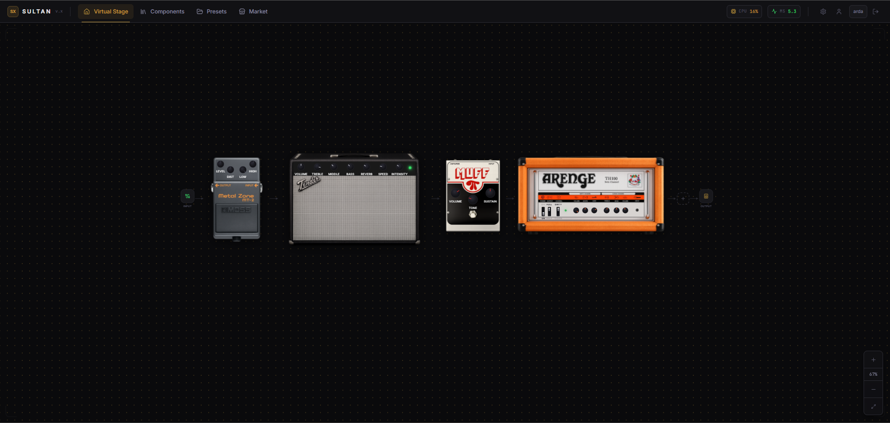
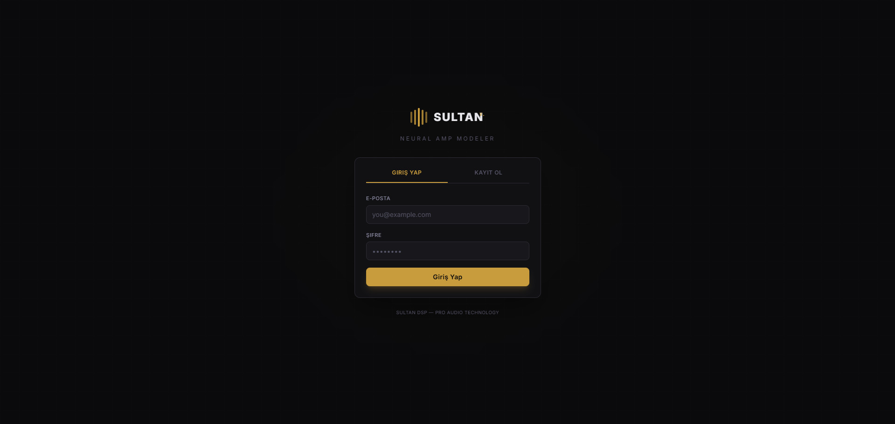
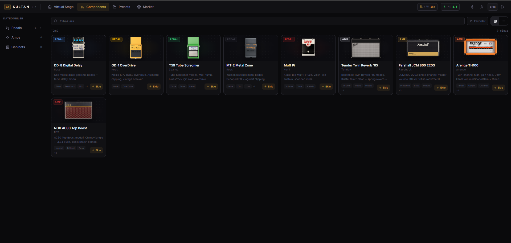
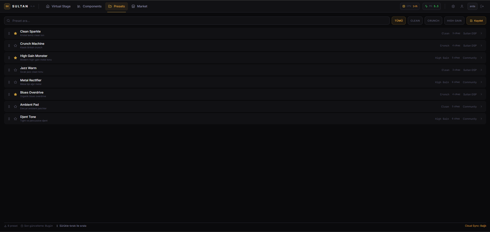

# SultanDSP V.X

Frontend prototype of a guitar signal-chain application. The interface is a single full-window stage: sign in, arrange effect devices, and adjust their controls. There is no audio engine in this repository.

Licensed under [GPL-3.0-or-later](LICENSE). [](https://www.gnu.org/licenses/gpl-3.0)

Repository: https://github.com/palaarda/sultandsp-vx

## Project Overview

Sultan V.X is a browser UI for building a linear pedalboard. The default view is an infinite pan/zoom canvas with an input, a row of devices, and an output. A component library supplies the devices that can be placed on that chain.

Authentication is Firebase Email/Password. Scene, favorites, and settings are stored in `localStorage` on this browser. Presets, the market, NAM import, the CPU meter, and the audio-engine controls are placeholders. They do not load, save, or process audio.

The app does not use URL routes. Sections are switched in memory from the top bar.

## Features

| Area | What works | What does not |
| --- | --- | --- |
| Sign-in | Email/password sign-in and registration through Firebase Auth. The session uses browser local persistence. Sign-out is in the top bar. | No other sign-in providers. |
| Virtual Stage | Add, remove, bypass, and edit devices. Reorder with the up/down controls on a device card. The chain is saved in `localStorage` and restored on reload. Invalid saved data falls back to an empty chain. Pan and zoom the canvas. | No sound. No cables beyond the fixed left-to-right chain. |
| Components | Static catalog of 5 pedals and 4 amp models. Search, category filter, and favorites. Favorites persist in `localStorage`. Device faces are PNGs with positioned knobs and switches. | The cabinet category is empty. Favorites are not synced to an account. |
| NAM card | File picker on the amp category. | Import waits briefly and writes a console message. It does not add a device or parse a NAM file. |
| Presets | A fixed list of eight example presets. Search, category filter, star toggle, and drag-and-drop reorder. | The list is in-memory mock data. Order and stars are lost on reload. The Save button has no action. "Cloud Sync: Bağlı" is static text. |
| Market | A Coming Soon screen. | No catalog, purchase, or download flow. |
| Settings | Controls for accent color, UI scale, animations, tooltips, sample rate, buffer size, oversampling, and latency compensation. Values persist in `localStorage`. | Appearance values are not applied to the rest of the UI. The theme colors stay the CSS defaults. Audio and engine values are stored only. The page marks those groups as "Backend Mock". |
| Profile | Shows the signed-in user's display name, email, and account creation date from Firebase Auth. | "Cloud Sync: Aktif" and "Sultan V.X Pro" are fixed placeholder strings. |
| Status bar | Shows the signed-in name. | The CPU figure is a simulated number. The millisecond figure is `(bufferSize / sampleRate) × 1000`, not a measured audio latency. |

## Tech Stack

- React 19 and TypeScript
- Vite 8
- Tailwind CSS 4
- Zustand
- Framer Motion
- Firebase Auth (Email/Password)
- Lucide React icons

`react-router-dom` is listed in `package.json` and is not imported anywhere. Navigation is Zustand state in `uiStore`.

Firebase Firestore is not initialized. No screen reads or writes Cloud Firestore.

## Screenshots

### Virtual Stage

The signal chain sits on an infinite canvas. The dotted field has no fixed page edge: drag to pan in any direction, and use the controls at the bottom right to zoom. Input is on the left, output is on the right, and the devices run between them.

<p align="center">
  
</p>

### Sign in

Email and password sign-in. The same card switches to registration.

<p align="center">
  
</p>

### Components

The device catalog. Pedals and amps can be filtered, searched, and added to the chain.

<p align="center">
  
</p>

### Presets

The preset list, with search, category filters, and drag-and-drop order. The rows in this screenshot are the built-in example presets, not a saved scene.

<p align="center">
  
</p>

## Getting Started

Requires Node.js 20 or newer.

```bash
git clone https://github.com/palaarda/sultandsp-vx.git
cd sultandsp-vx
npm install
```

Create a local env file from the template:

```bash
# macOS / Linux
cp .env.example .env

# Windows Command Prompt
copy .env.example .env
```

Fill in the Firebase values described below, then start the dev server:

```bash
npm run dev
```

Vite prints a local URL, usually `http://localhost:5173`.

Production build and local preview:

```bash
npm run build
npm run preview
```

`npm run build` runs `tsc` and then `vite build`.

Enable Email/Password in the Firebase project before registering a user: Firebase Console → Authentication → Sign-in method → Email/Password.

## Environment Variables

Vite exposes only variables that start with `VITE_`. `src/lib/firebase.ts` reads them when the app starts. A missing required variable throws before the UI renders.

Copy the names from Firebase Console → Project settings → Your apps → Web app → SDK setup and configuration.

| Variable | Firebase field | Required | Used for |
| --- | --- | --- | --- |
| `VITE_FIREBASE_API_KEY` | `apiKey` | Yes | Firebase app init |
| `VITE_FIREBASE_AUTH_DOMAIN` | `authDomain` | Yes | Firebase Auth |
| `VITE_FIREBASE_PROJECT_ID` | `projectId` | Yes | Firebase app init |
| `VITE_FIREBASE_STORAGE_BUCKET` | `storageBucket` | Yes | Passed to `initializeApp`. Storage is not used. |
| `VITE_FIREBASE_MESSAGING_SENDER_ID` | `messagingSenderId` | Yes | Passed to `initializeApp`. Cloud Messaging is not used. |
| `VITE_FIREBASE_APP_ID` | `appId` | Yes | Firebase app init |
| `VITE_FIREBASE_MEASUREMENT_ID` | `measurementId` | No | Copied into the config object when set. Analytics is not initialized. |

`.env` is gitignored. Commit `.env.example` only.

```env
VITE_FIREBASE_API_KEY=your_api_key_here
VITE_FIREBASE_AUTH_DOMAIN=your_project_id.firebaseapp.com
VITE_FIREBASE_PROJECT_ID=your_project_id
VITE_FIREBASE_STORAGE_BUCKET=your_project_id.firebasestorage.app
VITE_FIREBASE_MESSAGING_SENDER_ID=your_messaging_sender_id
VITE_FIREBASE_APP_ID=your_app_id
# VITE_FIREBASE_MEASUREMENT_ID=G-XXXXXXXXXX
```

These values are shipped to the browser. They identify the Firebase project; they are not a server secret. Do not add private service-account keys to this file.

## Project Structure

```
src/
├── assets/devices/          # Pedal and amp PNGs
├── components/
│   ├── audio/               # Knob, rocker, fader, VU meter
│   ├── auth/                # Login and registration
│   ├── fx/                  # Component library cards
│   ├── layout/              # Top bar and section shell
│   ├── scene/               # Canvas, chain, device cards
│   └── visuals/             # Pedal, amp, cab, and rack faces
├── hooks/                   # Auth subscription, canvas pan/zoom
├── lib/
│   ├── data/                # Static device catalog and knob layouts
│   ├── services/            # Scene, favorites, settings, catalog
│   ├── firebase.ts          # Firebase Auth initialization
│   └── types.ts
├── pages/                   # Stage, library, presets, market, settings, profile
├── stores/                  # Zustand stores
└── styles/index.css         # Tailwind theme tokens
```

Local storage keys:

| Key | Contents |
| --- | --- |
| `sultandsp-vx-scene` | Device chain: ids, parameters, bypass, order |
| `sultandsp-vx-favorites` | Favorite device ids |
| `sultandsp-vx-settings` | Settings form values |

`Fader` and `VuMeter` exist under `components/audio/` and are not mounted by any screen.

## Current Limitations

- No audio input, output, or DSP. Device parameters only update the on-screen controls and `localStorage`.
- One scene per browser profile. It is not tied to the Firebase user and does not sync across browsers.
- A saved scene that fails validation is discarded in memory. The broken text stays in `localStorage` until the next successful edit.
- Presets are mock data. The Save action does not capture the current chain.
- Market is a placeholder page.
- NAM import does not create a device.
- Settings for color, scale, animation, and tooltips are stored and not applied outside the settings form. Sample rate, buffer, oversampling, and latency compensation are stored and not sent to an engine.
- Profile cloud-sync and license lines are placeholders.
- The cabinet catalog has no devices.
- Firestore, Storage, Messaging, and Analytics are not used, even though some of their config fields are present.
- `react-router-dom` is an unused dependency.

## Future Improvements

- Connect the scene service to a real audio engine and drive the stored parameters from it.
- Apply saved appearance settings to the theme, or remove the controls that do not affect the UI.
- Replace the mock preset list with saved chains, including the current Save button.
- Persist favorites and scenes per Firebase user if cloud sync is actually added.
- Implement NAM import, or remove the card until a parser exists.
- Add cabinet models, or hide the empty category.
- Remove `react-router-dom` until the app has URL routes.

## License

GNU General Public License v3.0 or later. See [LICENSE](LICENSE). Derivative works that you distribute must also be released under GPL-3.0 or later, including source. There is no warranty.
